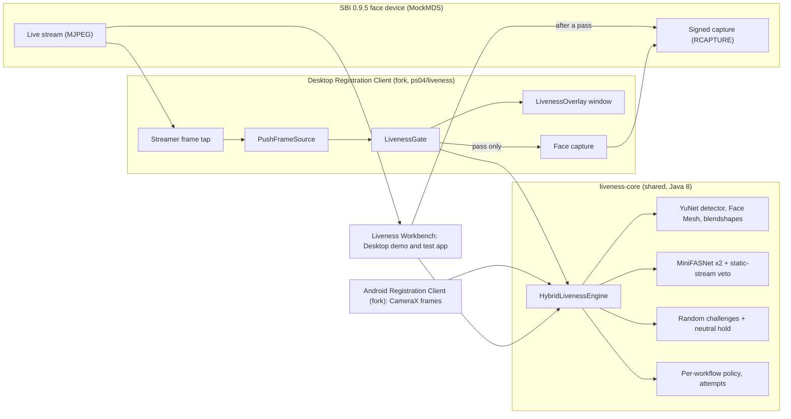

# MOSIP Face Liveness

Hybrid passive and active face liveness and presentation attack detection (PAD) for the MOSIP Desktop and Android Registration Clients. One shared engine checks face frames for liveness with no user action, escalates to random facial challenges when confidence is low, and blocks face capture and operator or supervisor authentication when liveness fails. Everything runs offline.

Built for MOSIP Decode 2026, Problem Statement 04, by team Incertainty.

> **Status:** `v0.2.5`. The real engine (`HybridLivenessEngine`), the Desktop overlay and liveness gate, the Liveness Workbench, and the Desktop Registration Client integration. Liveness is **off by default**; every rule is MOSIP configuration. See [CHANGELOG.md](CHANGELOG.md).

## Architecture



1. The face device streams frames. On the Desktop, the client's own stream is tapped, so no second stream is opened on the device.
2. The engine runs a passive check on every frame: two MiniFASNet PAD models, fused and taken as a median over a window, plus a veto for frozen streams. When policy asks, or confidence is low, it adds 2 to 3 random challenges and a final neutral hold.
3. Only a pass lets the client ask the device for the face. Failures are counted per face field (`max.retries`), and the attempt limit follows `on.max.retries`.
4. In the Workbench, the signed capture after a pass is also checked against the session: signature, echoed nonce, time, and the same scene as the live frames.

## Modules

| Module | Java | Purpose |
| --- | --- | --- |
| `liveness-core` | `--release 8` | Engine contract and implementation, shared by Desktop and Android (API 28) |
| `face-verification` | `--release 8` | 1:1 face verification (YuNet alignment + SFace), shared by both clients |
| `liveness-desktop` | 11 | Desktop frame sources (`MjpegFrameSource`, `PushFrameSource`), `LivenessGate`, JavaFX overlay |
| `liveness-eval` | 11 | Clip replay source for evaluation |
| `liveness-workbench` | 11 | The Liveness Workbench: the Desktop demo and test app (never part of the Registration Client) |

Related repositories:

- [registration-client](https://github.com/Incertainty-Labs/registration-client), branch `ps04/liveness`: Desktop client integration
- [android-registration-client](https://github.com/Incertainty-Labs/android-registration-client), branch `ps04/liveness`: Android client integration
- [mosip-mock-services](https://github.com/Incertainty-Labs/mosip-mock-services), branch `master`: MockMDS with a live face stream from a webcam or a clip, capture from the stream, and attack profiles

## Run the Liveness Workbench (Desktop demo)

The Workbench runs a liveness check the way the Desktop client does, on a MockMDS stream or a recorded clip, and shows the overlay, the result card (PAD scores, capture signature, freshness, scene binding) and an audit pane.

**Requirements:** a JDK 11 or 21 **with JavaFX** (for example Azul Zulu FX), Maven 3.9, and a webcam for live use. MockMDS needs Java 21.

### 1. Start MockMDS

```bash
git clone https://github.com/Incertainty-Labs/mosip-mock-services.git
cd mosip-mock-services/MockMDS
mvn clean install -Dmaven.test.skip=true -Dgpg.skip=true
cd target
java -cp "mock-mds-1.3.1.jar;lib/*" io.mosip.mock.sbi.test.TestMockSBI "mosip.mock.sbi.device.purpose=Registration" "mosip.mock.sbi.biometric.type=Biometric Device"
```

On Linux or macOS use `:` instead of `;` in the classpath. MockMDS listens on the first free port from 4501.

### 2. Start the Workbench

Windows, from this repository:

```bat
liveness-workbench\workbench.cmd
```

Any OS, the same steps by hand:

```bash
mvn -q -pl liveness-workbench -am install -DskipTests
mvn -q -f liveness-workbench/pom.xml dependency:copy-dependencies -DincludeScope=runtime -DoutputDirectory=target/lib
java -Dworkbench.models=models -cp "liveness-workbench/target/classes:liveness-workbench/target/lib/*" io.mosip.registration.liveness.workbench.WorkbenchApp
```

Optional system properties: `workbench.config` (a properties file with liveness keys; the default is a bundled demo config with liveness on) and `workbench.recordings` (where **Record** writes clips).

### 3. Try it

1. Source **MockMDS stream**, device `127.0.0.1:4501`, profile **webcam**. Pick a workflow (all seven MOSIP workflows) and press **Start**.
2. A real face passes the passive check in about 3 s. The capture follows, and the result card shows "capture bound".
3. Set Mode to **ACTIVE** to get random challenges (turn, look up, smile, open mouth, close eyes, blink), then the neutral hold.
4. Attacks: hold a photo on a phone screen to the webcam, or switch the profile to **static** (a frozen image). Both are refused before any capture (LIV-008). The `bonafide`, `print`, `screen` and `replay` profiles stream a clip you supply as `MockMDS/target/clips/<profile>.mjpeg`, for example one recorded with the Workbench's **Record**; no clips ship, since they would show people's faces. A clip can also be played directly with the Workbench's **Recorded clip** source.
5. **Reset attempts** starts the attempt count again; after `max.retries` failures the overlay shows the attempts-used-up screen.

## Desktop Registration Client integration

In the [registration-client fork](https://github.com/Incertainty-Labs/registration-client/tree/ps04/liveness) (MOSIP `master`, 1.2.0.2, Java 11):

- `Streamer` taps the live stream and hands each JPEG to `PushFrameSource`.
- `ResidentLivenessCheck` runs a `LivenessGate` per face field and shows it in a `LivenessOverlay` window.
- `GenericBiometricsController` asks the device for the face only after a pass. With no attempt left, Scan stays off (LIV-011). The exception photo is checked passive only. If liveness is on but the engine cannot load, the capture is blocked.

Build with a JDK 11 that includes JavaFX: `cd registration && mvn clean install -Dgpg.skip -DskipTests`. The client takes `liveness-core` and `liveness-desktop` v0.2.5 from JitPack.

Enable it through the client's synced configuration:

```properties
mosip.registration.face.liveness.enabled=true
mosip.registration.face.liveness.model.dir=<path to this repository's models folder>
```

**Not shown end to end:** a registration in the real client needs an onboarded operator on a MOSIP server. On MOSIP Collab, operator onboarding was still pending at submission, so the Workbench is the Desktop demo.

## Configuration

All keys start with `mosip.registration.face.liveness.`, and each can be set per workflow as `policy.<workflow>.<key>`.

| Key | Default | Meaning |
| --- | --- | --- |
| `enabled` | `false` | Master switch; off keeps the clients' behaviour unchanged |
| `mode` | `HYBRID` | `PASSIVE`, `ACTIVE`, `HYBRID` (challenges only when the passive check is not confident) or `OFF` |
| `passive.threshold` | `0.80` | Fused PAD score needed to pass passively |
| `challenge.pool` | all seven | Allowed challenges |
| `challenge.min.count`, `challenge.max.count` | `2`, `3` | Challenges per session |
| `challenge.timeout.ms` | `5000` | Time per challenge |
| `max.retries` | `3` | Attempts before LIV-011 |
| `on.max.retries` | `BLOCK` | `BLOCK`, `SUPERVISOR_OVERRIDE` or `EXCEPTION_FLOW` |

## Build and test

Requirements: JDK 21 and Maven 3.9.

```bash
mvn -B verify
```

381 automated tests at v0.2.5: `liveness-core` 273, `face-verification` 19, `liveness-desktop` 52, `liveness-eval` 4, `liveness-workbench` 33. CI runs them on every push.

## Using the library

Published through JitPack:

```xml
<repository>
  <id>jitpack.io</id>
  <url>https://jitpack.io</url>
</repository>

<dependency>
  <groupId>com.github.Incertainty-Labs.mosip-face-liveness</groupId>
  <artifactId>liveness-core</artifactId>
  <version>v0.2.5</version>
</dependency>
```

v0.2.3 and v0.2.4 have no JitPack artifacts; use v0.2.5.

The host application supplies ONNX Runtime: `com.microsoft.onnxruntime:onnxruntime:1.20.0` on Desktop (the newest that loads under the Registration Client's bundled Zulu 21.0.3) and `com.microsoft.onnxruntime:onnxruntime-android:1.28.0` on Android.

Models ship in [`models/`](models/) with their SHA-256 hashes, licences and sources in [`models/models.json`](models/models.json). `tools/export_minifasnet.py` regenerates the MiniFASNet ONNX files from the upstream weights and checks them against PyTorch.

## Licence

[Mozilla Public License 2.0](LICENSE). Third-party components and model licences are listed in [THIRD_PARTY_LICENSES.md](THIRD_PARTY_LICENSES.md).
